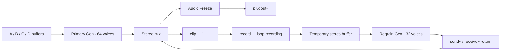

# Quadra / Grain V2

[English](README.md) | [简体中文](README.zh-CN.md)

**A four-source granular synthesizer for Max for Live, featuring XY morphing, independent waveform regions, audio freeze, and recursive regranulation.**

Quadra / Grain places four samples at the corners of an XY pad. A `pictslider` continuously controls their mixing weights. Each grain reads the selected region of all four sources, then passes through its own filter, envelope, and stereo gain stage. The output can be recorded into a temporary stereo buffer and processed by a second granular engine, producing evolving feedback textures.

The project is distributed as editable `.maxpat`, `.gendsp`, and `.js` source files. It is suitable for ambient textures, drones, experimental sampling, and studying granular scheduling and feedback in Gen.

## Features

- **Four sample slots:** drag audio into `live.drop`, with independent levels and waveform displays.
- **Independent playback regions:** select a region in each `waveform~`, or enter normalized IN / OUT values.
- **XY morphing:** A / B occupy the upper corners; C / D occupy the lower corners. Square-root weights provide continuous four-source crossfading.
- **64 primary grain voices:** sample-by-sample scheduling in Gen, idle-voice allocation, and no voice stealing.
- **Motion and randomness:** position, scan speed, playback rate, reverse probability, position spray, size variation, interval variation, pitch jitter, and pan spread.
- **Macro Randomness:** increases five randomization amounts while preserving their individual base settings.
- **Per-grain filtering and envelopes:** stereo state-variable filters, continuous Triangle / Hann / Trapezoid envelope shaping, and attack/decay bias.
- **32 feedback grain voices:** regranulate a temporary buffer with additional size and density multipliers and a pitch offset.
- **Audio freeze:** captures up to the most recent 250 ms of the final mix, with dual-window looping and a 20 ms transition crossfade.
- **Two internal LFOs:** Sine, Triangle, Ramp, and Sample & Hold, with selectable primary-engine destinations.
- **Live UI:** 57 `live.*` controls, four pages, and four control-surface parameter banks.

## Requirements

The recorded validation environment is **macOS, Max 9.1.3, and 44.1 kHz**. The source uses Max/MSP, Gen, Max JavaScript, and Max for Live objects. No third-party DSP externals are required.

Use in Ableton Live requires a Live installation with Max for Live available. This distribution contains a source patch that must be integrated into a Max for Live device; opening the `.maxpat` alone does not create a Live device. In standalone Max, `plugin~` / `plugout~` are host interfaces, so standalone auditioning requires a separate audio output connection.

Other Max versions, operating systems, and sample rates have not been covered by a compatibility test matrix.

## Quick start

1. Download the source and keep the main patch, three Gen files, UI script, and `media/` directory in their original relative locations.
2. Open a Max for Live device editor in Live and use the complete patch as the device's main patch. Avoid pasting the V2 network on top of an existing Quadra network: this creates duplicate objects and script-name conflicts.
3. Switch to Presentation mode. The default page is **SAMPLES / REGIONS**, and the four example samples load automatically.
4. Enable **RUN** and check the Live track's output, level, and monitoring configuration.
5. Drag audio into the A–D DROP areas. Select regions in the waveforms and adjust each sample's Level.
6. Move the XY pad to blend the sources. Use **GRAINS / MOTION** to adjust size, density, scanning, and pitch.
7. Add variation with **RANDOM / SPACE** and Macro Randomness. Configure LFOs on **MODULATION**.

Replacing a sample after initialization resets that slot's IN / OUT to the full region. Restored file paths take precedence over the example samples during startup.

## UI pages

| Page | Controls |
| --- | --- |
| GRAINS / MOTION | Grain Size, Density, Amount, Pitch, Position, Scan Speed, Rate, direction, envelope, filter, Feedback |
| RANDOM / SPACE | Position / size / density / pitch randomness, Pan, Spread, Filter Random, Regrain controls |
| SAMPLES / REGIONS | Four DROP areas, waveforms, independent Levels, IN / OUT |
| MODULATION | Rate, Depth, Target, and Shape for two LFOs |

RUN, Freeze, Output, Macro Randomness, Morph X / Y, and the XY pad remain visible. The filter-mode menu also stays visible. `GRAINS n + m` displays the active primary and regrain voice counts; SCAN displays the normalized scan position.

## Audio architecture



The feedback recording point is before Freeze. Freeze holds the final mixed audio while the primary engine, feedback engine, and scanner can continue running in the background.

See the **[technical documentation](docs/TECHNICAL.en.md)** for formulas, voice layouts, parameter ranges, message interfaces, and implementation limitations.

## File layout

```text
Quadra_Grain_V2/
├── Quadra_Grain_V2.maxpat            # UI, parameters, buffers, and MSP routing
├── quadra_resample_engine.gendsp    # Four-source primary granular engine
├── quadra_regrain_v3.gendsp         # Temporary-buffer regranulation engine
├── quadra_audio_freeze.gendsp       # Final-mix audio freeze
├── quadra_resample_ui.js            # Loading, regions, naming, and UI state
├── media/                          # Four original example WAV files
├── docs/TECHNICAL.en.md             # Detailed technical documentation
├── docs/TECHNICAL.md                # Chinese technical documentation
├── README.md                       # English project overview (default)
├── README.zh-CN.md                 # Chinese project overview
├── README.en.md                    # English project overview (alternate link)
└── VALIDATION.md                    # Recorded validation scope
```

The development directory also contains `tools/build.py`, `tools/ui_source.js`, parameter definitions, and runtime test tools. Older engines, probe patches, test recordings, and machine-specific device repair scripts are development artifacts rather than runtime dependencies. Use the file set above for a release instead of publishing the entire debugging directory.

## Known limitations

- **Morphing mixes sample waveforms.** It does not perform FFT-based spectral interpolation, pitch alignment, or phase alignment. Correlated material may interfere, and square-root weights do not guarantee equal loudness for every source combination.
- **Pitch and Playback Rate both affect read speed.** There is no independent duration-preserving pitch-shift algorithm. The grain envelope duration is controlled by Size.
- **Input Capture is not implemented.** Its control and `plugin~` connections exist, but the primary engine does not read incoming audio.
- **The internal LFO destinations Feedback and Feedback Delay currently have no effect.** They appear in the menu, but their calculated values are not sent from the primary engine to the separate regrain engine. Manual changes and direct host control of those parameters still work.
- **Macro Randomness and internal LFOs do not directly modulate regrain.** Regrain uses the shared controls' base values and does not inherit the primary engine's per-grain filter.
- **Output controls the primary layer rather than the final bus.** It does not directly attenuate the complete feedback return or frozen audio. Use the Live track level for final output control.
- **Regrain estimates the write position with an internal sample counter.** It is not connected to the actual `record~` write pointer. Treat Feedback Delay as a nominal value, particularly after DSP restarts or recording resets.
- **File paths and audio contents are stored separately.** `buffer~ @embed 0` does not embed user samples in the patch. Carry and relink audio files when moving between machines.
- **There is no dedicated final-bus limiter.** The feedback write path is clipped and each granular layer uses `tanh`, but their combined output can exceed either layer's individual amplitude.

## Building and validation

From a source checkout containing the development tools:

```bash
python3 tools/build.py
```

The generator uses only the Python standard library. It rebuilds the main patch, three Gen files, primary `.genexpr`, UI script, parameter list, and four example WAVs. Apply persistent changes to the generator or UI template as well, since regeneration overwrites generated files.

Recorded checks cover sample loading, mouse region selection, primary audio output, sustained Freeze after RUN is disabled, feedback regrain activity, and a return to silence after disabling RUN / Feedback. See [VALIDATION.md](VALIDATION.md). These records do not establish stability or performance across every parameter combination.

## Development directions

Possible extensions include actual write-pointer synchronization, independent regrain modulation and filtering, final-bus level control and limiting, input capture, portable sample paths, and automated regression tests.

## License

The source directory does not currently include an open-source license. The project author should select and add a `LICENSE` file defining the use and distribution terms for the code and example audio before publishing the repository as an open-source project.
