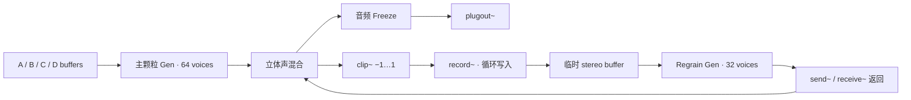

# Quadra / Grain V2

[English](README.md) | [简体中文](README.zh-CN.md)

**面向 Max for Live 的四采样源颗粒合成器：二维声音 morph、独立波形选区、音频冻结与递归颗粒反馈。**

Quadra / Grain 将四个 sample 放在二维平面的四个角，通过 `pictslider` 连续控制混合权重。每颗 grain 同时读取四个采样源各自选定的区域，再经过独立滤波、包络和声像处理。输出可以写入临时立体声 buffer，由第二个颗粒引擎重新切片，形成不断演化的反馈纹理。

项目以可编辑的 `.maxpat`、`.gendsp` 和 `.js` 源码发布。适合环境音、持续音、实验性采样和声音纹理制作，也可用于研究 Gen 中的颗粒调度与反馈实现。

## Max for Live 设备

打包设备：[Quadra Grain.amxd](<Quadra%20Grain.amxd>)。建议下载完整仓库，保留 Gen 文件、UI 脚本和示例音频。

## 功能

- **四个 sample 槽位**：`live.drop` 拖入音频，独立音量与波形显示。
- **独立取样区域**：在 `waveform~` 上拖动选择，或通过归一化 IN / OUT 精确输入。
- **二维 morph**：A / B 在上方，C / D 在下方；平方根权重提供连续四源交叉混合。
- **64 个主颗粒 voice**：Gen 逐采样调度、空闲 voice 分配、无抢占。
- **运动与随机**：Position、Scan Speed、Playback Rate、反向概率、位置散布、尺寸随机、密度随机、音高抖动和声像散布。
- **Macro Randomness**：同时增加五类随机量，保留各自基础旋钮设置。
- **每颗粒滤波与包络**：立体声状态变量滤波器、Triangle / Hann / Trapezoid 连续形状变化与 Attack/Decay Bias。
- **32 个 feedback grain voice**：从临时 buffer 再次 grain，附加尺寸倍率、密度倍率和音高偏移。
- **音频层 Freeze**：捕获最近最多 250 ms 的最终混合音频，双窗循环与 20 ms 切换交叉淡化。
- **两组内置 LFO**：Sine、Triangle、Ramp、Sample & Hold；可选择主引擎调制目标。
- **Live UI**：57 个 `live.*` 控件、四个页面、四组控制器参数 bank。

## 运行环境

已记录的运行验证环境为 **macOS、Max 9.1.3、44.1 kHz**。源码使用 Max/MSP、Gen、Max JavaScript 和 Max for Live 对象，无需第三方 DSP external。

在 Ableton Live 内使用，需要具备 Max for Live 的 Live 环境。当前发布的是源补丁，需要放入 Max for Live 设备编辑流程中使用；打开 `.maxpat` 本身不会自动创建 Live 设备。独立 Max 中的 `plugin~` / `plugout~` 是宿主接口，独立试听需要另接音频输出链路。

其他 Max 版本、操作系统与采样率尚未完成兼容性矩阵验证。

## 快速开始

1. 下载源码，保持主补丁、三个 Gen 文件、UI 脚本和 `media/` 的相对位置不变。
2. 在 Live 中打开一个用于承载该补丁的 Max for Live 设备编辑器，将完整补丁作为设备主体使用。避免把整张 V2 网络叠加粘贴到旧版 Quadra 网络上，否则会出现重复对象和脚本名冲突。
3. 切换到 Presentation。默认进入 **SAMPLES / REGIONS** 页面，四个示例 sample 会自动载入。
4. 点击 **RUN**；确认 Live 音轨输出、音量和监听路径正常。
5. 向 A–D 的 DROP 区域拖入音频。在 waveform 上拖出选区，设置每个 sample 的 Level。
6. 移动二维 pad，在四个 sample 之间混合；在 **GRAINS / MOTION** 页面调整尺寸、密度、扫描和音高。
7. 使用 **RANDOM / SPACE** 与 Macro Randomness 增加变化；在 **MODULATION** 页面设置 LFO。

初始化之后替换 sample 时，该槽位 IN / OUT 重置为完整区域。启动时恢复的路径优先于默认示例音频。

## UI 页面

| 页面 | 功能 |
| --- | --- |
| GRAINS / MOTION | Grain Size、Density、Amount、Pitch、Position、Scan Speed、Rate、方向、包络、滤波、Feedback |
| RANDOM / SPACE | 位置 / 尺寸 / 密度 / 音高随机、Pan、Spread、Filter Random、Regrain 参数 |
| SAMPLES / REGIONS | 四个 DROP、waveform、独立 Level、IN / OUT |
| MODULATION | 两组 LFO 的 Rate、Depth、Target、Shape |

RUN、Freeze、Output、Macro Randomness、Morph X / Y 与二维 pad 常驻，滤波模式菜单也保持可见。`GRAINS n + m` 分别显示主层与二次颗粒层的活动 voice 数；SCAN 显示归一化扫描位置。

## 音频架构



反馈记录点位于 Freeze 之前。Freeze 固定最终混合音频，后台主颗粒、反馈引擎和扫描可以继续运行。

详细公式、voice 数据布局、参数范围、消息接口与实现限制见 **[技术说明](docs/TECHNICAL.md)**。

## 文件结构

```text
Quadra_Grain_V2/
├── Quadra_Grain_V2.maxpat            # UI、参数、buffer 和 MSP 路由
├── quadra_resample_engine.gendsp    # 四源主颗粒引擎
├── quadra_regrain_v3.gendsp         # 临时 buffer 二次颗粒引擎
├── quadra_audio_freeze.gendsp       # 最终混合音频的 Freeze
├── quadra_resample_ui.js            # 拖放、选区、命名和页面状态
├── media/                          # 四个原创示例 WAV
├── docs/TECHNICAL.md                # 详细技术说明
├── README.md
└── VALIDATION.md                    # 已完成验证的范围
```

开发目录还包含 `tools/build.py`、`tools/ui_source.js`、参数清单与运行测试工具。旧引擎、Probe 补丁、测试录音和本机设备修复脚本属于开发过程文件，不是运行依赖。发布时使用上面的文件集合，避免上传整个调试目录。

## 已知限制

- **Morph 是 sample 波形混合**，没有 FFT 频谱插值、音高对齐或相位对齐。相关素材可能产生干涉；平方根权重不能保证所有素材响度一致。
- **Pitch 与 Playback Rate 共同改变读取速度**。没有保持时长的独立移调算法；grain 的包络时长由 Size 决定。
- **Input Capture 当前未实现**：控件和 `plugin~` 连线存在，但主引擎没有读取输入音频。
- **内置 LFO 的 Feedback / Feedback Delay 目标当前不生效**：菜单包含它们，但主层计算值没有传给独立 regrain。手动或宿主直接改变对应参数仍然有效。
- **Macro Randomness 与内置 LFO 不直接作用于 regrain**；regrain 读取共享旋钮基础值，也没有继承主层的每颗粒滤波器。
- **Output 位于主层输出**，不在最终总线上。反馈返回和冻结音频不会被这个旋钮直接整体衰减；最终音量可由 Live 音轨控制。
- **Regrain 用内部逐采样指针估计写入位置**，没有连接 `record~` 的真实写指针。DSP 重启或录制重置后，Feedback Delay 应视为名义值。
- **路径与音频内容分离保存**：`buffer~ @embed 0` 不把用户 sample 嵌入源码，跨机器使用需要携带并重新定位素材。
- **最终总线没有独立 limiter**：反馈写入端有硬限幅，两层各自有 `tanh`，但混合输出仍可能超过单层幅度。

## 构建与验证

在包含开发工具的源码目录中运行：

```bash
python3 tools/build.py
```

生成器只依赖 Python 标准库，会重建主补丁、三个 Gen 文件、主引擎 `.genexpr`、UI 脚本、参数清单和四个示例 WAV。长期修改应同时落实到生成器或 UI 模板，避免生成时覆盖。

已完成验证包括拖放加载、鼠标选区、主颗粒出声、RUN 关闭后 Freeze 持续出声、feedback regrain 活动，以及关闭 RUN / Feedback 后恢复静音。范围见 [VALIDATION.md](VALIDATION.md)。这些记录不等同于所有参数组合的稳定性与性能测试。

## 开发方向

可继续扩展真实写指针同步、regrain 独立调制与滤波、最终总线音量与 limiter、输入捕获、路径迁移和自动化回归测试。

## 许可

当前源码目录尚未包含开源许可证。公开 GitHub 仓库时，应由项目作者选择并添加 `LICENSE`，明确代码与示例音频的使用和分发条件。
